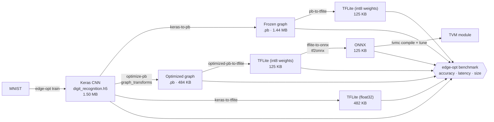

# CNN Edge Optimization: Keras → TFLite / ONNX / TVM

[](https://github.com/kishorhange111/cnn-edge-optimization-tflite-onnx-tvm/actions/workflows/ci.yml)

This project takes a trained Keras digit-recognition CNN and runs it through a pipeline that makes it **smaller and faster for edge devices**: graph freezing and cleanup, TensorFlow Lite conversion with int8 weight quantization, ONNX export, and Apache TVM compilation with auto-tuning. Every model is checked with the same accuracy, latency and size benchmark.

It started as a final-year B.Tech (CSE) project at DKTE Society's Textile and Engineering Institute, Ichalkaranji (2022-23). The full write-up is in [`docs/`](docs/).

## Highlights

- **12x smaller.** The model goes from 1.50 MB (Keras `.h5`) to 125 KB (TFLite / ONNX).
- **About 6x lower latency.** ONNX Runtime took 0.617 ms per image, against 3.764 ms for the original Keras model (from the project report; see [Results](#results)).
- **One package, one CLI** (`edge-opt`) covers training, each conversion step and benchmarking. All paths can be configured, and nothing is hard-coded.
- **One benchmark for every format** (`.h5`, `.pb`, `.tflite`, `.onnx`): top-1 accuracy on MNIST, mean/median/p95 latency, and file size.

## Pipeline



| Step | What it does | Why it helps |
|---|---|---|
| **Freeze** (`keras-to-pb`) | Turns variables into constants in one `GraphDef` | Produces a self-contained graph that any TF tool can load |
| **Optimize** (`optimize-pb`) | `graph_transforms` strips Identity/CheckNumerics/StopGradient, XLA attributes and device placements, and folds batch norms. It keeps only the input→output path | Takes out training-only nodes (the plain frozen graph still carries the Adam optimizer slots): 1.44 MB → 484 KB |
| **TFLite** (`*-to-tflite`) | Fuses ops (conv + bias + ReLU). With `OPTIMIZE_FOR_LATENCY` it also stores weights as int8 (dynamic-range quantization) | Weights take about 4x less space, and inference is faster on mobile/embedded CPUs |
| **ONNX** (`tflite-to-onnx`) | Converts to a framework-neutral format with `tf2onnx` | Runs under ONNX Runtime, and is the input format TVM expects |
| **TVM** (`scripts/tvm_compile_and_tune.sh`) | Compiles for a target, then auto-tunes operator schedules | Searches for kernels that are fast on the specific target hardware |

## Results

All numbers below come from the project's own records: the committed model files, the report in [`docs/`](docs/final_report_2023-06-11.pdf) and the [TVM notebook](notebooks/tvm_compiler_tuning.ipynb).

### Model size (committed files in `models/`)

| Model | File | Size | vs. Keras |
|---|---|---:|---:|
| Keras | `digit_recognition.h5` | 1.50 MB | 1.0x |
| Frozen graph | `digit_recognition_frozen.pb` | 1.44 MB | 1.0x |
| Optimized graph | `digit_recognition_optimized.pb` | 484 KB | 3.1x smaller |
| TFLite from Keras (float32) | `digit_recognition_keras.tflite` | 482 KB | 3.1x smaller |
| TFLite from frozen graph | `digit_recognition_frozen.tflite` | 125 KB | 12.0x smaller |
| TFLite from optimized graph | `digit_recognition_optimized.tflite` | 125 KB | 12.0x smaller |
| ONNX from optimized TFLite | `digit_recognition_optimized.onnx` | 125 KB | 12.0x smaller |

### Inference latency (project report, Figs. 2, 10, 11)

Each figure is the mean of 100 single-image inferences on a Windows CPU machine with TensorFlow 1.15.

| Model | Mean latency | Speed-up vs. Keras |
|---|---:|---:|
| Keras (`.h5`) | 3.764 ms | 1.0x |
| Frozen graph (`.pb`) | 2.205 ms | 1.7x |
| ONNX Runtime (`.onnx`) | 0.617 ms | **6.1x** |

> **Caveat.** The original scripts timed each call with `time.time()`. On Windows that clock only ticks every few milliseconds, so in the report's logs many single calls show up as ~0 ms and others as ~8 ms. Treat these means as rough figures. The FPS values printed in the same logs are not meaningful, because they average `1/t` over calls that measured ~0 ms. The benchmark in this repo uses `time.perf_counter()` and works out FPS from the mean latency instead. The report records no TFLite latency and no per-format test accuracy. Run `edge-opt benchmark` to measure both on your own hardware.

### TVM auto-tuning (TVM notebook, Google Colab CPU, `--repeat 100`)

The TVM workflow was tried out on the ResNet50-v2 ONNX tutorial model, not on the digit CNN:

| Build | Mean | Median | Min |
|---|---:|---:|---:|
| `tvmc compile` (untuned) | 591.64 ms | 511.36 ms | 485.95 ms |
| `tvmc tune` + compile (auto-tuned) | 488.34 ms | 406.35 ms | 388.16 ms |

Auto-tuning cut mean latency by about 17% and median latency by about 21%, and the top-5 predictions stayed the same. The run in the report (Fig. 7) showed the same pattern: 636.86 ms untuned against 454.04 ms tuned. To apply the same steps to the digit model, use [`scripts/tvm_compile_and_tune.sh`](scripts/tvm_compile_and_tune.sh).

## Quickstart

```bash
git clone https://github.com/kishorhange111/cnn-edge-optimization-tflite-onnx-tvm.git
cd cnn-edge-optimization-tflite-onnx-tvm
python -m venv .venv && source .venv/bin/activate
pip install -e ".[dev]" -r requirements.txt

# Benchmark every committed model: accuracy on 1,000 MNIST test images,
# plus latency and size
edge-opt benchmark

# Benchmark one file, timing 200 inferences, and save the results as JSON
edge-opt evaluate models/digit_recognition_optimized.onnx --iterations 200 --json results.json

# Size and latency only (no MNIST download needed)
edge-opt benchmark --skip-accuracy
```

To rebuild the models from scratch, use a TensorFlow 1.15 environment (Python 3.7). The freezing and `graph_transforms` steps exist only in TF 1.x:

```bash
pip install -r requirements-tf1.txt && pip install -e .
edge-opt train --epochs 2            # -> models/digit_recognition.h5
edge-opt convert all                 # every conversion step, in pipeline order
edge-opt convert keras-to-onnx       # optional, needs TensorFlow 2 + tf2onnx
```

Every command reads from and writes to the models directory. You can change it with `--models-dir` or the `EDGE_OPT_MODELS_DIR` environment variable. Each `convert` step also accepts `--input` and `--output`:

```bash
edge-opt --models-dir /data/exp1 convert optimized-pb-to-tflite --output /tmp/model.tflite
```

`python -m edge_opt ...` works the same way as `edge-opt ...`.

## Project layout

```
cnn-edge-optimization-tflite-onnx-tvm/
├── src/edge_opt/               # the pipeline (installable package, `edge-opt` CLI)
│   ├── paths.py                #   models directory + file name for every stage (configurable)
│   ├── data.py                 #   MNIST loading and preprocessing shared by all steps
│   ├── train.py                #   CNN definition (119,652 params) and training
│   ├── convert.py              #   h5 → frozen pb → optimized pb → tflite → onnx
│   ├── runners.py              #   one predict() wrapper per format (Keras/pb/TFLite/ONNX)
│   ├── benchmark.py            #   framework-free accuracy / latency / size helpers
│   ├── evaluate.py             #   runs the benchmark against model files
│   └── cli.py                  #   `edge-opt` command line
├── scripts/
│   └── tvm_compile_and_tune.sh # tvmc compile → tune → compile → run
├── models/                     # trained and converted model artifacts
├── notebooks/
│   ├── model_conversion.ipynb      # training + freezing exploration (TF 1.15)
│   └── tvm_compiler_tuning.ipynb   # TVM compile / tune / timing runs
├── docs/                       # final report (PDF) and presentation (PPTX)
├── tests/                      # pytest suite (TF/ONNX tests skip if not installed)
├── .github/workflows/ci.yml    # lint + tests on every push and pull request
├── Makefile                    # make install / install-dev / lint / test / bench
├── pyproject.toml              # package metadata, dependencies, ruff + pytest config
├── requirements.txt            # pinned runtime stack (TensorFlow 2)
├── requirements-tf1.txt        # legacy TF 1.15 stack for the original conversion steps
└── requirements-dev.txt        # lint + test tooling
```

<details>
<summary>Old file names (as they appear in the report)</summary>

| Report / original name | Now |
|---|---|
| `train.py` | `edge-opt train` (`src/edge_opt/train.py`) |
| `keras_to_frozen.py`, `pb_to_optimized_pb.py` | `edge-opt convert keras-to-pb` / `optimize-pb` |
| `normal_pb_to_tflite.py`, `optimized_pb_to_tflite.py`, `keras_to_tflite.py` | `edge-opt convert pb-to-tflite` / `optimized-pb-to-tflite` / `keras-to-tflite` |
| `h5_to_onnx.py`, `Tflite_To_Onnx.txt` | `edge-opt convert keras-to-onnx` / `tflite-to-onnx` |
| `keras_evaluation.py`, `Normal_Pb_Evaluation.py`, `Tflite_evaluation.py`, `Onnx_Evaluation.py` | `edge-opt evaluate` / `edge-opt benchmark` |
| `Digit_Recognition.h5` / `.pb`, `Optimized_pb.pb` | `models/digit_recognition.h5`, `_frozen.pb`, `_optimized.pb` |
| `Keras_Converted_Tflite_…`, `Normal_Tflite_…`, `Optimized_Digit_Recognition.tflite` | `models/digit_recognition_keras.tflite`, `_frozen.tflite`, `_optimized.tflite` |
| `Optimized_Onnx.onnx` | `models/digit_recognition_optimized.onnx` |

</details>

## Development

```bash
pip install -e ".[dev]" onnxruntime
ruff check . && ruff format --check .
pytest
```

CI (GitHub Actions) runs ruff and pytest on Python 3.10 and 3.12. TensorFlow is not installed in CI, so TF-dependent tests skip themselves. The ONNX Runtime test still runs the committed model end to end.

`make check` runs the same lint and test steps as CI, and `make help` lists the other commands. Optionally, `pip install pre-commit && pre-commit install` runs ruff before every commit.

## Tech stack

Python · TensorFlow / Keras · TensorFlow Lite · ONNX · ONNX Runtime · tf2onnx · Apache TVM · Netron (graph inspection) · pytest · ruff · GitHub Actions

## Team

Chetan Bavache · Pranav Bhokare · Akshay Chougale · Omkar Dhanale · Kishor Hange

Guide: Prof. P. M. Gavali, Department of Computer Science & Engineering, DKTE, Ichalkaranji

Originally published at [G11-Mega-Project-2023/Deep-Neural-Network-Optimizations](https://github.com/G11-Mega-Project-2023/Deep-Neural-Network-Optimizations).
